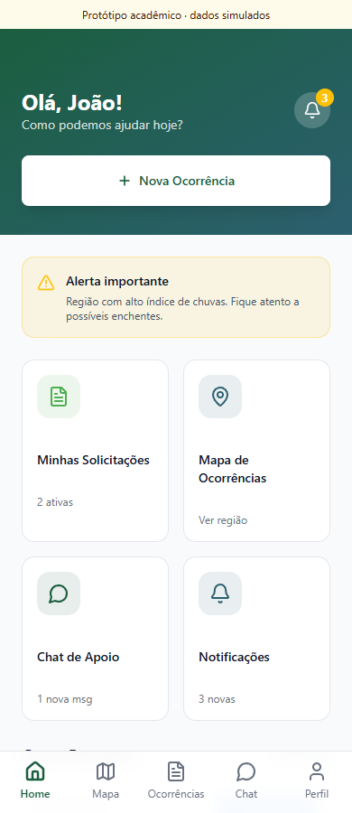
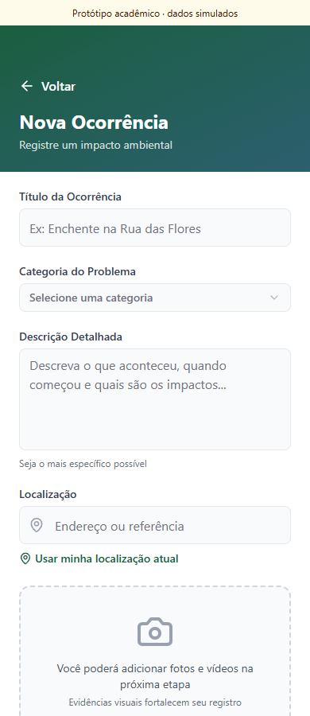
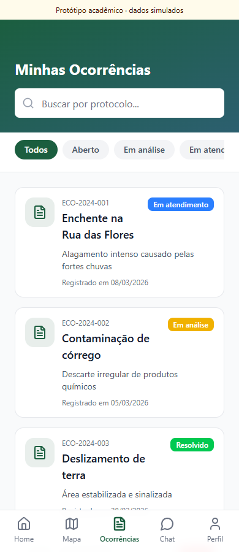

# EcoHelp · Ocorrências ambientais e sociais

Protótipo acadêmico de uma plataforma para registrar problemas ambientais e sociais, acompanhar ocorrências e organizar a comunicação com os usuários.

**Frontend web e híbrido Android · React / TypeScript · API Java / Spring Boot**

<p>
  
  
  
</p>

## Tecnologias

| Camada | Tecnologias e uso |
|---|---|
| Interface | React 18, TypeScript, Vite, Tailwind CSS e Radix UI |
| Navegação | React Router, formulários e componentes compartilhados |
| Android híbrido | Capacitor 7; interface web em um projeto Android |
| API | Java 17, Spring Boot 3.4, Spring Web e Bean Validation |
| Dados | Spring Data JPA, PostgreSQL; H2 para demonstração e testes locais |
| Credenciais | PBKDF2 com salt por senha e respostas por DTO sem senha |

## O que existe nesta versão

| Recurso | Estado |
|---|---|
| Login, cadastro e navegação visual | Demonstração local, sem autenticação real |
| Formulário, lista, mapa, chat e notificações | Telas com dados e comportamentos simulados |
| `POST /users` e `GET /users` | API implementada e testada separadamente |
| Entidade de ocorrência | Modelo e repositório JPA existentes |
| API REST de ocorrências | Ainda não implementada |
| Integração frontend → backend | Ainda não implementada |
| Empacotamento Android | Estrutura Capacitor presente; APK não validado nesta publicação |

## Rodar a interface

Requisitos: Node.js 22 e npm.

```powershell
cd frontend
npm.cmd ci
npm.cmd run dev
```

Abra `http://127.0.0.1:5173`. No login demonstrativo, use e-mail e senha fictícios; nenhum acesso ao backend é feito. Não utilize dados pessoais reais.

```powershell
npm.cmd run typecheck
npm.cmd run build
```

## Rodar a API local sem PostgreSQL

Requisitos: JDK 17 e Maven 3.9 ou superior.

```powershell
cd backend
mvn.cmd spring-boot:run "-Dspring-boot.run.profiles=demo"
```

API em `http://127.0.0.1:8080`. O perfil `demo` usa banco em memória descartável.

```powershell
Invoke-RestMethod http://127.0.0.1:8080/users -Method Post -ContentType 'application/json' -Body '{"name":"Pessoa Demo","email":"demo@example.com","password":"senha-ficticia-123"}'
Invoke-RestMethod http://127.0.0.1:8080/users
```

A senha é codificada com PBKDF2 antes de persistir e não retorna em nenhuma dessas respostas. O limite de senha é de 8 a 128 caracteres. Os endpoints ainda não têm autenticação/autorização: o servidor escuta somente no localhost por padrão e serve para estudo local.

Para PostgreSQL, siga o [guia do backend](backend/README.md). Para Android, siga o [guia do frontend](frontend/README.md).

## Organização e evolução

- `frontend`: telas, navegação e projeto Android Capacitor.
- `backend`: API REST e persistência.
- `docs/assets`: capturas reais da interface.
- `docs/proposta-academica-original.pdf`: proposta original.

Próximas etapas: autenticação, API de ocorrências, integração da interface, persistência das evidências e validação Android.

## Validação

TypeScript, build web e navegação de demonstração verificados. Os testes da API cobrem hash e ausência de senha nas respostas, rejeição de cadastros inválidos e limite de tamanho. O perfil H2 não substitui a validação em PostgreSQL.

## Contexto e autoria

Trabalho acadêmico FIAP, publicado no portfólio de Ericles Santos. A documentação de entrega preserva o contexto original e os créditos que acompanham o material. As marcas citadas identificam o desafio acadêmico; este repositório não é um produto oficial das empresas.

[Detalhes da validação](docs/validacao.md).
